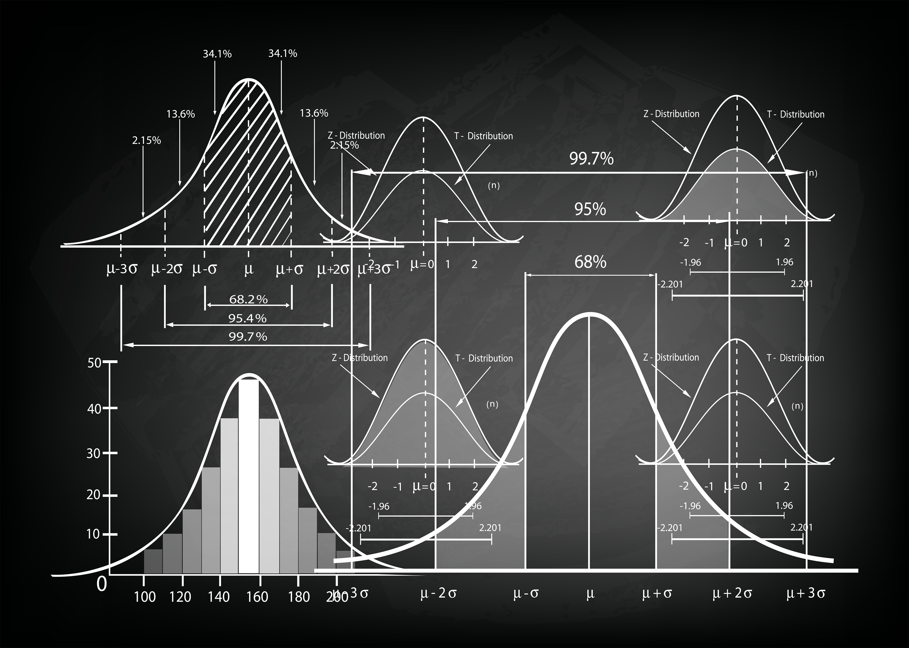

::: {.editorial-content .about-layout}
::: {.editorial-intro}
[About]{.editorial-kicker}

# Junior Jumbong

Je suis analyste quantitatif et statisticien. J’écris sur la statistique et la finance, avec un intérêt particulier pour le risque de crédit et les méthodes de modélisation.

Je rassemble ici mes articles publiés dans Towards Data Science et les exercices corrigés que je mets à disposition des étudiants de première année à l’ENSAI.

[LinkedIn](https://www.linkedin.com/in/junior-jumbong-258330211/){.editorial-link} · [Towards Data Science](https://towardsdatascience.com/author/jumbongjunior1999/){.editorial-link}
:::

{.about-illustration fig-alt="Courbes et histogrammes représentant des distributions de probabilité"}
:::
